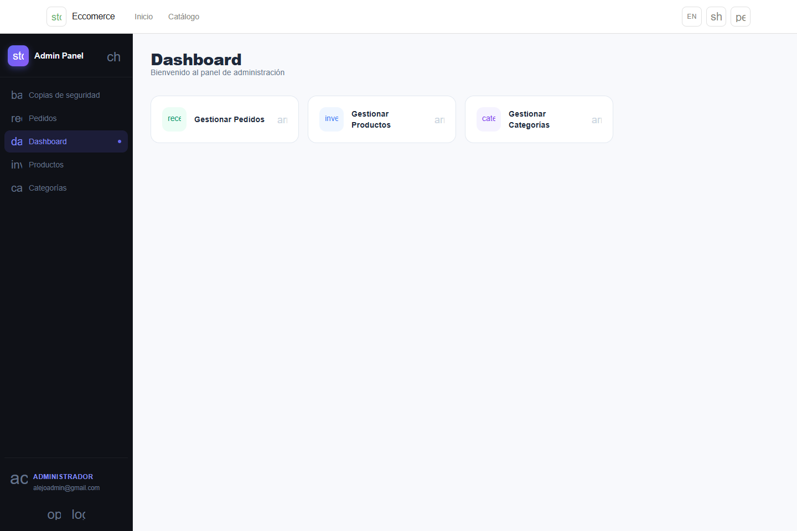
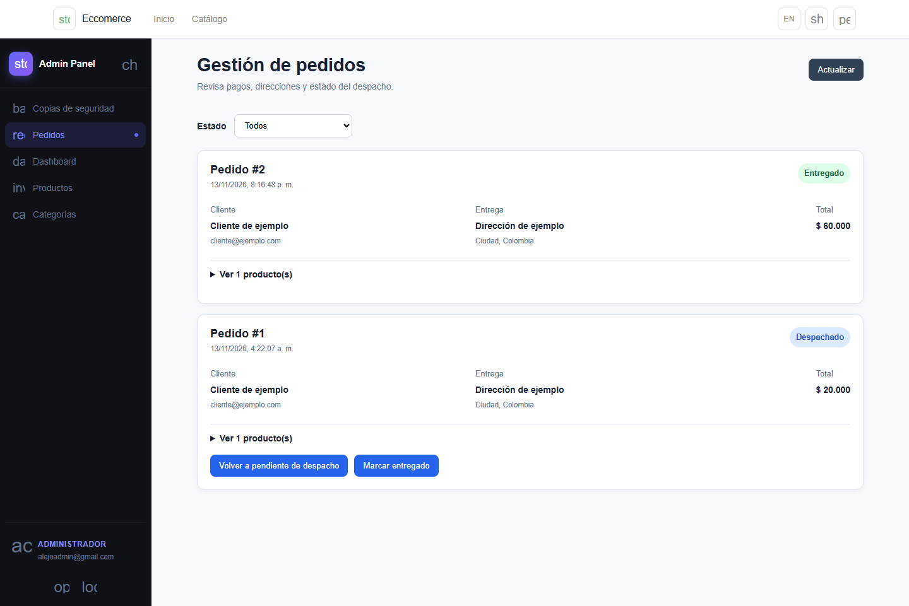
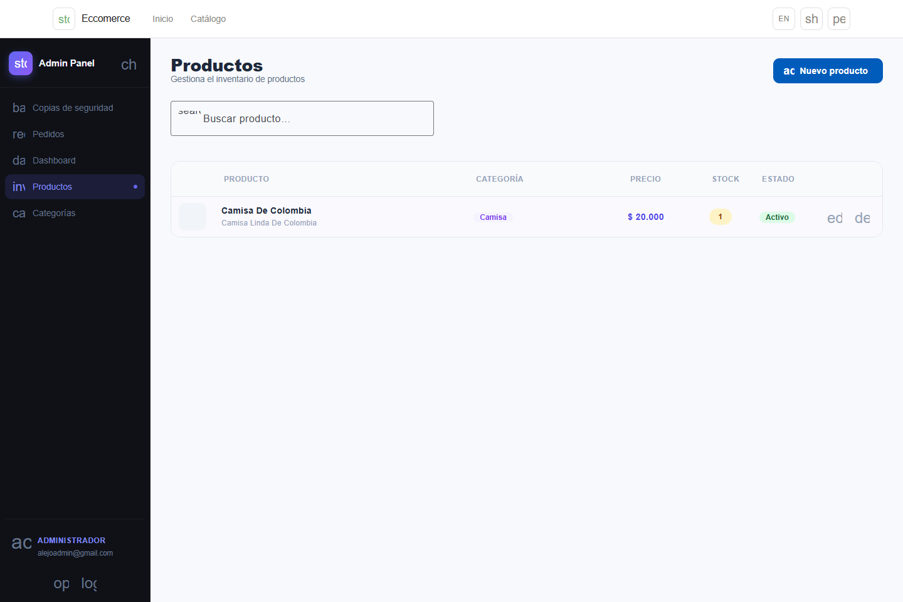
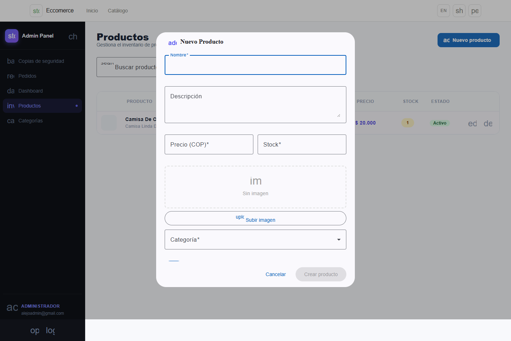
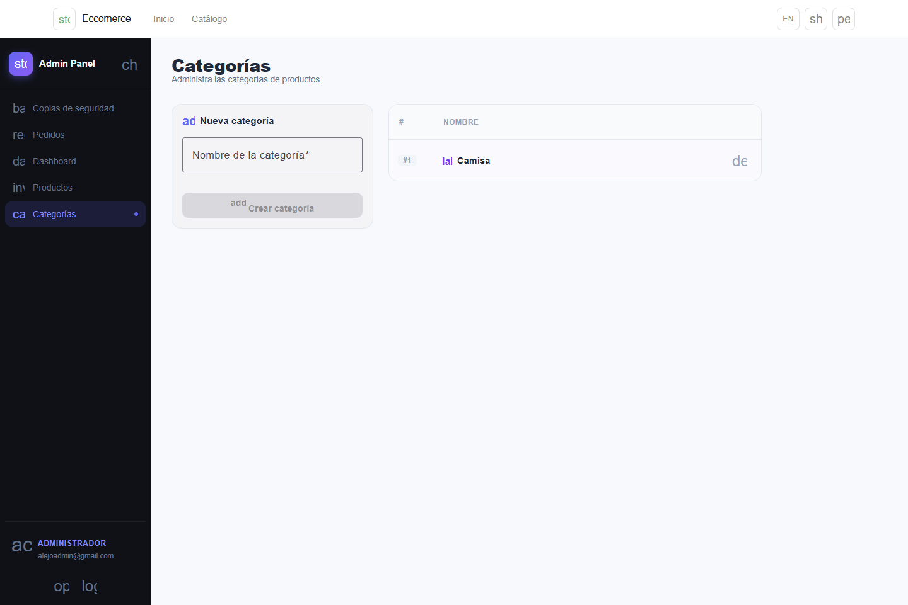
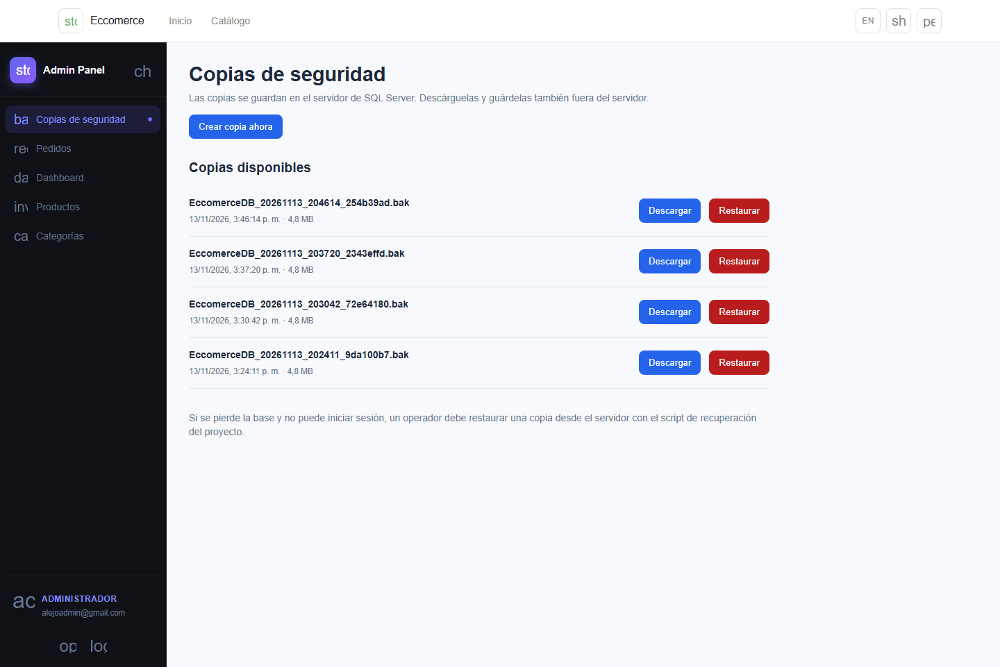

# Manual de usuario: administración de la tienda

Este capítulo explica las funciones disponibles para una cuenta con rol **Admin** en la versión actual de EccomerceProject. Las capturas se tomaron en el entorno de prueba; los datos de clientes y direcciones se sustituyeron por ejemplos. Solicite las credenciales de acceso al responsable del entorno. No las incluya en documentos ni repositorios.

## 1. Entrar y recorrer el panel

1. Abra la tienda y pulse **Iniciar sesión**.
2. Escriba el correo y la contraseña de su cuenta administradora. Tras entrar, abra **Admin Panel** si la aplicación no le lleva allí automáticamente.
3. En **Dashboard** use las tarjetas **Gestionar Pedidos**, **Gestionar Productos** y **Gestionar Categorías**. El menú lateral también ofrece **Copias de seguridad**.
4. Para volver a la tienda, use **Ver catálogo** al pie del menú. Para terminar, pulse **Cerrar sesión**.

Una cuenta de comprador no puede acceder a estas funciones. Si el panel no aparece, compruebe que inició sesión con una cuenta administradora y recargue la página.

## 2. Gestionar pedidos

Abra **Pedidos** desde el menú o la tarjeta del dashboard. La lista muestra primero los pedidos más recientes. Cada tarjeta incluye número, fecha, cliente, dirección de entrega y total. Pulse **Ver productos** para revisar cantidades, precios y notas de entrega. Use **Estado** para filtrar y **Actualizar** para consultar cambios recientes.

| Estado mostrado | Significado | Acción disponible |
| --- | --- | --- |
| Pendiente de pago | Wompi aún no confirmó el pago. | **Cancelar pedido**. Confirme el número antes de aceptar. |
| Pendiente de despacho | El pago se confirmó y el pedido espera preparación. | **Marcar despachado**. |
| Despachado | El pedido salió para entrega. | **Volver a pendiente de despacho** si se marcó por error, o **Marcar entregado**. |
| Entregado | La entrega terminó. | Solo consulta. |
| Cancelado | El pedido se anuló antes de confirmar el pago. | Solo consulta. |

**Ejemplo de despacho:** filtre por **Pendiente de despacho**, abra el pedido y compruebe dirección, teléfono y productos. Una vez entregado al transportador, pulse **Marcar despachado**. Cuando la entrega termine, pulse **Marcar entregado**. Si todavía no salió, use **Volver a pendiente de despacho**.

El administrador no puede marcar manualmente un pedido como pagado: ese estado llega de la confirmación de Wompi. La aplicación no emite reembolsos; para cancelar un pedido pagado se debe gestionar el reembolso en Wompi y seguir un procedimiento administrativo fuera de este panel. Los cambios guardados se muestran al comprador en **Mis pedidos** al regresar a la pestaña o durante la actualización automática, que ocurre cada 15 segundos mientras la pestaña está visible.

## 3. Gestionar productos

Abra **Productos**. La tabla muestra nombre, categoría, precio, stock y si el producto está activo. El cuadro **Buscar producto** filtra por nombre o categoría.

### Crear un producto

1. Compruebe que la categoría ya existe. Si falta, créela primero en **Categorías**.
2. Pulse **Nuevo producto**.
3. Escriba **Nombre**, **Descripción**, **Precio (COP)** y **Stock**. El precio debe ser mayor que cero y el stock no puede ser negativo.
4. Seleccione **Categoría**. La imagen es opcional; use **Subir imagen** si desea mostrarla en el catálogo.
5. Active o desactive **Producto activo** y pulse **Crear producto**. Revise que aparezca en la tabla.

### Editar, desactivar o eliminar

Use el icono de edición de la fila para cambiar precio, descripción, stock, categoría, imagen o estado activo. Desactivar un producto evita ofrecerlo para compras nuevas y conserva su registro. Para eliminarlo, use el icono de papelera y confirme; esta acción no se puede deshacer. Si un producto forma parte de pedidos anteriores, revise las restricciones del servidor antes de intentar eliminarlo.

## 4. Gestionar categorías

Abra **Categorías**. Escriba el nombre en **Nueva categoría** y pulse **Crear categoría**. Después podrá seleccionarla al crear o editar productos. La tabla muestra las categorías existentes y ofrece un icono de papelera para eliminarlas.

Si una categoría tiene productos asociados, el servidor puede impedir su eliminación. Revise primero qué productos la usan.

## 5. Copias de seguridad

1. Abra **Copias de seguridad** y pulse **Crear copia ahora**. Espere el mensaje de confirmación.
2. Compruebe que el archivo `.bak` nuevo aparezca en **Copias disponibles**.
3. Pulse **Descargar** y guarde otra copia fuera del servidor. El archivo contiene datos de la tienda y de sus usuarios; manténgalo protegido.
4. Use **Restaurar** solo cuando deba reemplazar la base de datos actual por el contenido de una copia. Confirme el archivo correcto y vuelva a iniciar sesión al terminar.

El botón crea copias manuales. Si la base se pierde y ya no puede iniciar sesión, el panel no sirve para recuperarla: un operador debe usar el [procedimiento de restauración externa](copias-de-seguridad.md). No restaure una copia solo para comprobar que el botón funciona, porque reemplaza los datos actuales.

## 6. Solución de problemas

| Situación | Qué hacer |
| --- | --- |
| No aparece el panel o una acción devuelve acceso denegado | Inicie sesión de nuevo con una cuenta Admin. |
| No aparece un pedido nuevo | Pulse **Actualizar** y compruebe si el pago sigue pendiente; use el filtro **Todos**. |
| No se puede marcar un pedido como despachado | Compruebe que está en **Pendiente de despacho** y que Wompi confirmó el pago. |
| No se puede cancelar un pedido | Desde el panel solo se cancelan pedidos pendientes de pago. Los pagados requieren gestionar el reembolso fuera de la aplicación. |
| No se puede crear o descargar una copia | Solicite revisar la carpeta de copias y el acceso de SQL Server y de la API; consulte la [guía técnica de copias](copias-de-seguridad.md). |

La versión actual no ofrece gestión de usuarios, números de guía de transporte ni reembolsos automáticos.
